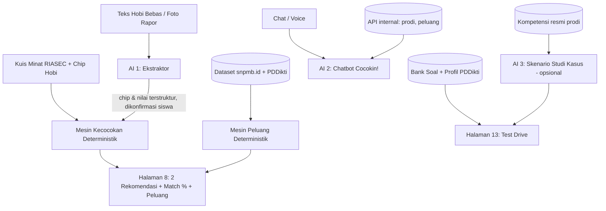

# Product Requirements Document (PRD) — Cocokin! 🎮🎓
**Platform Cek Kecocokan Jurusan, Prediksi Peluang PTN & Simulator Test Drive Interaktif**
*Tema: Education · Subtema: Siswa SMA Kelas Akhir (Menentukan Jurusan, Memilih Jalur Pendidikan & Merencanakan Karir)*
*Dokumen Spesifikasi Teknis & Desain · Versi 2.1 (Revisi Data — Hackathon JOINTS UGM 2026)*

---

## 0. Catatan Revisi v2.0 → v2.1 (Penyesuaian dengan Dataset Nyata)

Versi 2.0 ditulis sebelum data terkumpul. Versi 2.1 menyesuaikan setiap bagian dengan dataset yang **benar-benar sudah ada** di folder `Cocokin/Data` (lihat `README.md` dan `AUDIT_DATA.md`). Ringkasan perubahan:

| # | Bagian | v2.0 | v2.1 (alasan) |
|---|---|---|---|
| 1 | Sumber data PTN | "SIDATA PTN Kemendikbud" | **Endpoint publik snpmb.id** (SIDATA PTN sudah tidak aktif). 5.150 prodi, **146 PTN** (Universitas Terbuka hanya SNBP). |
| 2 | Data sekolah/NPSN | "Dapodik Pusdatin" | **Daftar Kuota Sekolah SNBP 2026 (snpmb.id)**: 42.669 sekolah lengkap dengan akreditasi **dan kuota eligible resmi per jurusan** — lebih akurat daripada hitung manual dari persen. |
| 3 | Form Hobi & Minat (Hal. 3) | 8 chip + teks bebas, dicocokkan Gemini | **Form minat tervalidasi RIASEC** (O*NET Mini Interest Profiler 30 item, Bahasa Indonesia) + chip hobi sebagai pelengkap. Persentase kecocokan dihitung **deterministik**, bukan oleh LLM. |
| 4 | Bahan SNBP (Hal. 5) | Rapor + peringkat + sertifikat | Ditambah **nilai TKA** (wajib & menjadi "validator" rapor sejak SNBP 2026) dan **nilai mapel pendukung** (Kepmendikdasmen 102/M/2025). |
| 5 | Rumus keketatan (6.2-B) | Daya tampung ÷ peminat, ambang 3%/8% | SNBP pakai **diterima ÷ peminat** (di 3.134 data, jumlah diterima > daya tampung). Ambang dikalibrasi ulang dari sebaran data nyata. |
| 6 | Indeks peluang (6.2-C) | Multiplier tetap (alumni 1.2, akreditasi 1.1, dst.) | Model berbasis **komponen resmi SNBP** + posisi siswa di kuota sekolah + keketatan prodi; keluaran berupa **rentang berlabel estimasi**. |
| 7 | Blacklist alumni (Hal. 7) | Penalti −0.25 | Diubah jadi **pertanyaan opsional, bobot kecil, dan diberi label "bukan aturan resmi SNPMB"** (tidak ada regulasi resmi soal penalti tidak daftar ulang). |
| 8 | Test Drive (Hal. 13) | Gemini generate bebas untuk 5.150 prodi, termasuk "Mata Kuliah Asli" | **Bank soal terverifikasi + data PDDikti** jadi sumber utama; Gemini hanya membuat skenario yang **di-grounding** ke kompetensi resmi prodi. "Mata Kuliah Asli" diganti **"Kompetensi Lulusan Resmi"** (data mata kuliah per prodi tidak tersedia publik). |
| 9 | Taksonomi 8 klaster (Bagian 5) | Angka perkiraan (±420, ±980, …) | Angka **dihitung dari data** + klaster ke-9 **Pendidikan & Keguruan**. |
| 10 | Model AI | Gemini 1.5 Flash | Gemini 1.5 Flash sudah dihentikan Google → pakai **Gemini 2.5 Flash** (atau Flash terbaru di AI Studio). |

---

## 1. Ringkasan Eksekutif & Identitas Produk

| Parameter | Spesifikasi |
| :--- | :--- |
| **Nama Produk** | **Cocokin!** |
| **Tagline** | *"Cari yang Cocok, Uji Rasanya, Tembus Kampus Impianmu!"* |
| **Target Pengguna** | Siswa SMA/SMK/MA kelas 12, pejuang SNBP & SNBT, serta guru BK |
| **Gaya Desain Visual** | **Retro Pixel 8-Bit Arcade / RPG** dipadukan dengan **Google Color Palette** yang ramah, vibrant, dan berjiwa muda |
| **Inti Nilai (Core Value)** | Menjawab 2 ketakutan terbesar anak SMA: *"Apakah aku bisa lolos?"* (Peluang Kuota & Keketatan) dan *"Apakah aku bakal nyesel?"* (Kecocokan Minat & Test Drive Rasa Kuliah) |
| **Tech Stack Utama** | Next.js 15 (App Router, TypeScript), Tailwind CSS, PostgreSQL/Supabase, Google Gemini 2.5 Flash API (Google AI Studio). 🔄 **Data:** snpmb.id (daya tampung, peminat, diterima, kuota sekolah), PDDikti Kemdiktisaintek (akreditasi & kompetensi prodi), O*NET (profil minat RIASEC) |

---

## 2. Masalah & Latar Belakang (Hook Lomba)

1. **Tragedi Salah Jurusan:** Angka "87% mahasiswa merasa salah jurusan" sering dikutip atas nama *Indonesia Career Center Network (ICCN)*. 🔄 *Catatan: sumber primer angka ini sulit diverifikasi; siapkan sumbernya di pitch deck atau ganti dengan formulasi yang aman, misal "banyak mahasiswa merasa salah jurusan".* Akibatnya: IPK anjlok, kehilangan motivasi, hingga pindah jurusan atau *drop-out*.
2. **Aturan "One-Way Ticket" SNBP 2026 (resmi, snpmb.id):** Siswa yang lulus SNBP 2026 **tidak bisa** mendaftar UTBK-SNBT 2026 maupun jalur Mandiri di PTN mana pun. Salah memilih berarti terkunci di prodi itu.
3. **Keterbatasan Solusi yang Ada di Pasar:**
   - *Kalkulator SNBP biasa:* Hanya menghitung angka tanpa peduli apakah siswa bahagia di jurusan tersebut.
   - *Tes Minat Bakat biasa:* Hanya memberi label kepribadian tanpa tahu realitas kuota dan persaingan kampus.
   - *Ketiadaan Preview Perkuliahan:* Siswa memilih jurusan murni dari nama keren dan brosur, tanpa pernah tahu kompetensi yang dipelajari.
4. **Solusi Cocokin!:** Menghadirkan **Dual-Engine System**:
   - **Engine 1: Test Drive 60 Detik** (merasakan studi kasus & kompetensi nyata prodi, bersumber data resmi PDDikti).
   - **Engine 2: Admission Matcher** (menghitung peluang berbasis data resmi snpmb.id 2021–2026: daya tampung, peminat, jumlah diterima, kuota sekolah per akreditasi, aturan satu provinsi, dan nilai TKA).

---

## 3. Design System: 8-Bit Pixel x Google Color Palette

*(Tidak berubah dari v2.0.)*

### 3.1. Color Palette (Google Retro Spectrum)
- 🔵 **Google Blue (`#4285F4`):** Warna primer untuk tombol aksi utama (*Next*, *Mulai*, *Search*), link navigasi, dan elemen SAINTEK.
- 🔴 **Google Red (`#EA4335`):** Warna peringatan, tombol bahaya (*Back*, *Batal*), dan status *Sangat Ketat*.
- 🟡 **Google Yellow (`#FBBC05`):** Warna lencana prestasi, bintang rekomendasi, peringatan *Ketat*, dan aksen gold.
- 🟢 **Google Green (`#34A853`):** Warna status *Longgar/Aman*, tombol konfirmasi, dan elemen SOSHUM.
- ⬛ **Pixel Borders & Shadow:** `#1A1A1A` dengan `border: 3px solid #1A1A1A` dan `box-shadow: 4px 4px 0px #1A1A1A`.
- ⚪ **Background Surfaces:** Retro Canvas Off-White (`#F8F9FA` light mode) dan Retro Slate Dark (`#202124` dark mode).

### 3.2. Tipografi
- **Headings & Badges:** *'Press Start 2P'* atau *'Silkscreen'*.
- **Body & Teks Panjang:** *'Outfit'* atau *'Inter'* dengan font-weight 500–600.

---

## 4. Spesifikasi 13 Halaman (1-to-1 Mapping dengan Low Fidelity.jpeg)

```
[1. Beranda Hero] ──scroll──> [2. CTA Orang 8-Bit: 'Isi Preferensi Dulu Yu']
                                         │
                        [Klik 'Mulai']   ▼
                        ┌────────────────────────────────────────────────────────┐
                        │ 🔐 AUTH GATE: Cek Status Login Google (Gmail)          │
                        ├────────────────────────────────────────────────────────┤
                        │ • Belum Login  ──> Modal Login Google (Gmail OAuth)    │
                        │ • Sudah Login & Belum Isi ──> [3. Preferensi: Minat]   │
                        │ • Sudah Login & Sudah Isi ──> Langsung loncat ke [8]!  │
                        └────────────────────────────────────────────────────────┘
                                         │
                                         ▼
[3. Preferensi: Hobi & Minat] ──> [4. Preferensi: Check Jalur SNBP/SNBT]
                                           │
                                           ▼
[5. Bahan SNBP: NPSN, Rapor, TKA] ──> [6. Alamat & Reputasi Alumni] ──> [7. Riwayat Alumni & Input SNBT TO]
                                                                                │
                                                                                ▼
[11. Drawer Option] <── [10. Chatbot Cocokin!] <── [9. Banner Chat] <── [8. Halaman Cocokin (Hasil)]
         │                                                                      │
         ▼                                                                      ▼
[12. Katalog Test Drive] ──────────────────────────────────────────> [13. Detail Mini Challenge]
```

> **⚡ Smart Routing & Long-Lived Session:**
> Jika user sudah login dan **sudah pernah mengisi preferensi sebelumnya**, saat berada di Beranda (1) dan men-scroll ke bawah melewati Hero, sistem **otomatis langsung mengarahkan ke Halaman 8 (Cocokin)** tanpa mengulang form preferensi.

---

### Halaman 1: Beranda (Hero Section)
* **Navbar Atas:**
  - Kiri: Logo Pixel **Cocokin!** dengan ikon dadu/gamepad 8-bit.
  - Kanan: Menu Navigasi `[Beranda]` `[Cocokin]` `[Edit Preferensi]` `[Login / Logout]`.
* **Hero Content:**
  - **Teks Headline (Hook):** *"Jangan sampai salah jurusan. Uji dulu, baru pilih!"* (🔄 gunakan angka 87% hanya jika sumbernya bisa ditunjukkan).
  - **Sub-headline:** 🔄 *"Uji rasa kuliahmu dalam 60 detik, cocokkan minat, dan hitung peluang tembus PTN lewat data resmi SNPMB & PDDikti."*
  - **Hero Art:** Ilustrasi kampus impian bergaya pixel 8-bit.
  - **Scroll Indicator:** Arrow pixel berkedip *"Jelajahi ↓"*.

---

### Halaman 2: Ajakan Onboarding & Google Auth Gate (CTA Section)
*(Tidak berubah dari v2.0.)*
* Ilustrasi karakter siswa pixel 8-bit melambaikan tangan, balon dialog *"Isi preferensi dulu yuu, biar ramalan Cocokin! makin akurat!"*, tombol `[ MULAI SEKARANG ▶ ]` (Google Green).
* **Google OAuth Gate:** belum login → modal login Google → Halaman 3; sudah login & sudah ada preferensi → langsung Halaman 8.
* **Sesi:** NextAuth, HttpOnly cookie, masa aktif 30 hari; preferensi tersimpan di profil akun.
* 🔄 **Privasi (pengguna sebagian besar di bawah 18 tahun):** simpan hanya data yang dibutuhkan; alamat lengkap tidak disimpan (cukup provinsi & kab/kota); foto rapor/sertifikat dihapus setelah diekstrak; sediakan tombol hapus akun & data.

---

### Halaman 3: Wizard Preferensi — Hobi & Minat 🔄 *(direvisi)*
* **Progress Bar Atas:** `[1. Minat (Aktif)]` ────── `[2. Bahan]`
* **Bagian A — Kuis Minat 30 Detik-an (Inti, Tervalidasi):**
  - Judul: *"Seberapa suka kamu dengan kegiatan ini?"*
  - Instruksi: *"Bayangkan kamu melakukannya sebagai pekerjaan. Jangan pikirkan gaji atau apakah kamu sudah bisa."*
  - **30 kartu kegiatan** dari `form_minat_riasec_items.csv` (O*NET Mini Interest Profiler, sudah diterjemahkan & diadaptasi). Tampil 5 kartu per layar (gaya kartu RPG), urutan berselang R-I-A-S-E-C.
  - Skala jawaban 5 tombol pixel: `😖 Sangat tidak suka` · `🙁 Tidak suka` · `😐 Ragu` · `🙂 Suka` · `🤩 Sangat suka`.
  - Opsi "Mode Lengkap 60 item" untuk hasil lebih tajam (dipakai otomatis bila profil terlalu datar).
  - Hasil langsung: **kode Holland 3 huruf** (mis. "ICR — Pemikir Sistematis") ditampilkan sebagai "class" karakter RPG.
* **Bagian B — Chip Hobi (Pelengkap, bobot maks 20%):**
  - 8 chip dari v2.0 tetap dipakai, masing-masing dipetakan ke RIASEC di `form_minat_config.json`:
    `[💻 Ngoprek Kode & Gadget]`→I/R/C · `[🎨 Gambar & Desain Visual]`→A · `[💼 Jualan & Rintis Bisnis]`→E/C · `[🔬 Eksperimen Sains & Riset]`→I · `[⚖️ Debat & Analisis Hukum]`→E/S · `[✍️ Menulis Cerita & Konten]`→A/E · `[🩺 Peduli Kesehatan & Medis]`→S/I · `[🌿 Lingkungan & Sosial]`→S/R
  - Daftar lengkap 18 chip hobi tersedia di config bila ingin ditambah.
* **Bagian C — Mapel Favorit (maks 3):** dipakai untuk mencocokkan mapel pendukung SNBP.
* **Kolom Input Bebas (Textarea, opsional):** tetap ada; Gemini hanya **mengekstrak** teks bebas menjadi chip hobi/mapel (bukan menentukan rekomendasi).
* **Tombol Kontrol Bawah:** `[ ◀ Kembali ]` dan `[ Selanjutnya ▶ ]`.

---

### Halaman 4: Wizard Preferensi — Pemilihan Jalur Evaluasi
* `[✓] SNBP` dan/atau `[✓] SNBT`; form halaman 5–7 menyesuaikan.
* 🔄 **Validasi aturan resmi:**
  - Lulusan 2024/2025 (gap year) → SNBP otomatis dinonaktifkan (SNBP hanya untuk siswa kelas akhir tahun berjalan).
  - Siswa yang lulus SNBP 2024–2026 tidak bisa ikut SNBT 2026 → tampilkan peringatan.

---

### Halaman 5: Formulir Bahan SNBP — NPSN, Rapor & TKA 🔄 *(direvisi)*
* **Cek NPSN Sekolah (Auto-Lookup):**
  - Input 8 digit NPSN atau ketik nama sekolah (fuzzy search).
  - Data dari `ak_sekolah_kuota_snbp_2026.csv` (42.669 sekolah):
    - **Nama Resmi Sekolah, Kab/Kota, Provinsi** — terisi otomatis.
    - **Akreditasi** — terkunci (`A` 40%, `B` 25%, `C` / tidak terakreditasi 5%).
    - **Kuota Eligible Resmi per Jurusan** — mis. *"SMAN 1 X, jurusan MIPA: 54 siswa eligible dari 135"* (angka resmi SNPMB, bukan hitungan kasar).
  - Jika sekolah belum mengisi PDSS (kuota 0) atau akreditasi kosong → tampilkan *"Data kuota sekolahmu belum tersedia, kami pakai perkiraan dari persen akreditasi."*
* **Rapor & Peringkat:**
  - Rata-rata seluruh mapel semester 1–5.
  - **Nilai mapel pendukung** (pilihan dari daftar mapel di Kepmendikdasmen 102/M/2025, maks 2 sesuai prodi incaran).
  - Peringkat paralel di jurusan (mis. 12 dari 135).
  - Opsi upload foto/PDF rapor → diekstrak Gemini, lalu **wajib dikonfirmasi siswa** sebelum dipakai.
* 🔄 **Nilai TKA (baru, wajib):** input nilai TKA Bahasa Indonesia, Matematika, Bahasa Inggris, dan mapel pilihan. Sejak SNBP 2026, TKA dipakai sebagai validator rapor (rapor bisa terkoreksi naik/turun).
* **Sertifikat & Prestasi:** tingkat (Sekolah/Kab-Kota/Provinsi/Nasional/Internasional) + bidang + peringkat. Bobot per tingkat disimpan di config.

---

### Halaman 6: Formulir Bahan SNBP — Alamat & Reputasi Alumni
* **Provinsi & Kab/Kota:** 🔄 terisi otomatis dari NPSN (bisa diubah). Dipakai untuk aturan satu provinsi dan jarak sekolah → kampus (`ak_kabupaten_kota.csv` + koordinat PTN).
* **Reputasi Guild Alumni (Self-report):** radio 8-bit tetap seperti v2.0 (👑 Langganan PTN Top · ⚔️ Rutin Lolos PTN · 🛡️ 1–5 Siswa/Tahun · 🌲 Sekolah Baru).
  - 🔄 Data rekam jejak alumni per sekolah **tidak tersedia publik**. Jawaban siswa dipakai sebagai faktor kecil (lihat 6.2-C). Untuk demo tersedia `ak_alumni_sintetis_snbp.csv` (berlabel SINTETIS).
* **Kampus Basis Utama Alumni (Multi-Select Tags):** `[ + UGM ]` `[ + ITB ]` `[ + UI ]` … `[ + Tambah Kampus Lain ]` (autocomplete dari 146 PTN + `alias_pencarian.csv`).

---

### Halaman 7: Riwayat Alumni & Bahan SNBT (Try Out) 🔄 *(direvisi)*
* **Riwayat Alumni Tidak Daftar Ulang (opsional):**
  - Pertanyaan: *"Apakah ada alumni sekolahmu yang lulus SNBP tapi tidak daftar ulang?"* `[ 🟢 Tidak / Tidak tahu ]` `[ ⚠️ Pernah ]` + kampus.
  - 🔄 Ditampilkan dengan label *"Bukan aturan resmi SNPMB — hanya dipertimbangkan sebagai faktor risiko kecil."* Tidak ada penalti besar seperti −0.25 di v2.0.
* **Bahan SNBT:**
  - **7 Subtes resmi UTBK:** PU, PPU, PBM, PK, Literasi B. Indonesia, Literasi B. Inggris, Penalaran Matematika.
  - Pilihan **sumber TO** (nama bimbel / "skala IRT 200–1000" / "tidak tahu"), karena skala TO antar bimbel berbeda.
  - **History TO:** `[ ➕ Tambah Riwayat TO ]` → grafik kenaikan skor.
  - **Portofolio:** wajib untuk prodi seni & olahraga; daftar prodi yang mensyaratkan diambil dari kolom `portofolio` (229 prodi).
* **Tombol:** `[ ◀ Kembali ]` dan `[ ✨ Selesai & Cocokkan! ]`.

---

### Halaman 8: Halaman Cocokin (Dashboard Rekomendasi Utama)
* **Header:** *"HASIL REKOMENDASI JURUSAN & KAMPUSMU"* + kode Holland siswa.
* **2 Kartu Rekomendasi (patuh aturan satu provinsi SNBP):**
  - **Kartu 1 (Dream Goal):**
    - Nama Jurusan (contoh: *Teknologi Informasi*), Badge `SAINTEK`, kode Holland prodi (`CIE`).
    - **Kecocokan Minat:** `[██████████░] 94% Match` — 🔄 dihitung dari kecocokan profil RIASEC (bukan LLM).
    - **Peluang per Kampus** (🔄 contoh memakai data nyata 2025):
      - UGM — rasio diterima SNBP **3,7%** → 🔴 *Sangat Ketat*
      - UNY — rasio diterima SNBP **3,6%** → 🔴 *Sangat Ketat*
  - **Kartu 2 (Safety Net, serumpun):**
    - Nama Jurusan (contoh: *Sistem Informasi*), `[████████░░░] 86% Match`.
    - UPN "Veteran" Yogyakarta — rasio diterima SNBP **8,1%** → 🟡 *Ketat*
  - 🔄 Setiap angka peluang tampil sebagai **rentang** (mis. "Peluangmu 35–50%") + label *estimasi* + tombol "Kenapa?" yang menyebut data yang dipakai.
  - 🔄 **Kartu info tambahan dari PDDikti:** akreditasi prodi, rasio dosen:mahasiswa, rata-rata masa studi.
* **Banner Jembatan ke Test Drive:** *"Mau rasakan studi kasusnya sebelum memilih?"* `[ 🎮 Test Drive Jurusan Ini ▶ ]`.

---

### Halaman 9: Banner Konsultasi Interaktif
*(Tidak berubah.)* *"Beri Tahu Kami Jurusan & Kampus Apa yang Kamu Incar!"* `[ 💬 Di Chat yuu ▶ ]`.

---

### Halaman 10: Halaman Chatbot Interaktif ("Cocokin!")
* Header, sapaan personal, tombol `[ ≡ Opsi ]`, 3 quick-prompt, chat bubble 8-bit, input teks/upload/voice — **seperti v2.0**.
* 🔄 **Aturan grounding:** semua angka (daya tampung, rasio, peluang, akreditasi) yang disebut chatbot **diambil dari API internal** (`/api/prodi`, `/api/peluang`), bukan dikarang LLM. Jika data tidak ada, chatbot menjawab "datanya tidak tersedia".
* Contoh quick-prompt 2 tetap valid: data Informatika ITB/STEI dan ITS tersedia lengkap.

---

### Halaman 11: Drawer / Modal Menu Chatbot
*(Tidak berubah.)* `[🎮 Test Drive]` `[✏️ Edit Preferensi]` `[📜 Riwayat Chat]` `[🚪 Logout]`.

---

### Halaman 12: Halaman Katalog Test Drive Jurusan (5.150 Prodi)
* **Cakupan Data:** 🔄 **5.150 prodi dari 146 PTN** (PTN akademik, politeknik, PTKIN, termasuk Universitas Terbuka yang hanya SNBP), bersumber dari snpmb.id.
* **Instant Search Bar:** fuzzy search + 🔄 kamus singkatan `alias_pencarian.csv` (TI, DKV, FK, HI, UGM, POLBAN, dll.).
* **Filter:**
  - Rumpun: `[ 🔵 SAINTEK ]` (2.952) dan `[ 🟢 SOSHUM ]` (2.198).
  - Jenjang: `[ Semua ]` `[ S1 ]` (3.823) `[ D4 ]` (787) `[ D3 ]` (540).
  - Klaster keilmuan: 🔄 9 klaster (lihat Bagian 5).
  - 🔄 Filter tambahan: Akreditasi prodi (Unggul/Baik Sekali/Baik), Provinsi, "Wajib Portofolio".
* **Kartu Prodi:** nama prodi, PTN, badge jenjang & rumpun, 🔄 badge akreditasi, tombol `[ 🎮 Test Drive Jurusan Ini ▶ ]`. Virtualized list.

---

### Halaman 13: Halaman Detail Test Drive (Mini Challenge) 🔄 *(direvisi)*
* **Header:** `[ ◀ Kembali ke Katalog ]`, Nama Jurusan & Kampus.
* **Badge Hook:** *"Yuk rasakan cara berpikir mahasiswa [Nama Prodi] selama 60 detik!"*
* 🔄 **Sumber soal (berlapis, semua prodi tercakup):**

| Urutan | Sumber | Cakupan |
|---|---|---|
| 1 | **Soal kompetensi khusus kampus** — `ak_soal_spesifik_prodi_ptn_v2.csv` (dari teks kompetensi resmi PDDikti) | 1.862 prodi |
| 2 | **Soal kompetensi umum** — `ak_soal_umum_prodi.csv` (dari prodi sama di kampus lain) | 3.288 prodi sisanya |
| 3 | **Soal konten keilmuan per rumpun** — `bank_soal_simulasi.csv` (5 soal/rumpun, 78 rumpun) | semua prodi |
| 4 | **Skenario studi kasus Gemini (opsional)** — di-grounding ke kompetensi & deskripsi prodi dari `ak_profil_prodi_ptn.json`, divalidasi skema JSON, diberi label "dibuat AI" | semua prodi, fallback ke 1–3 bila gagal |

* **Komponen Mini Challenge:** skenario/pertanyaan + 🔄 **4 opsi [A]–[D]** (mengikuti bank soal), timer 60 detik.
* **Setelah Menjawab (Instant Reveal):**
  - **Feedback Instan:** pembahasan dari kolom `pembahasan`.
  - **Reality Check:** 🔄
    - **Kompetensi Lulusan Resmi** (2–3 butir dari PDDikti) — *menggantikan "Mata Kuliah Asli" karena data mata kuliah per prodi tidak tersedia publik dan berisiko dikarang AI.*
    - **Fakta Kampus:** akreditasi, rasio dosen:mahasiswa, rata-rata masa studi (PDDikti).
    - **Fakta Persaingan:** daya tampung 2026 & rasio diterima SNBP 2025 (snpmb.id).
  - **Refleksi:** *"Seru atau melelahkan?"* → memperbarui skor kecocokan di Halaman 8.

---

## 5. Taksonomi & Arsitektur Indeks 5.150 Prodi 🔄 *(angka dihitung dari data)*

Setiap prodi diklasifikasikan ke **78 rumpun** (`classify.py`), lalu dikelompokkan ke **9 klaster** untuk filter:

```
👾 INDEKS 5.150 PROGRAM STUDI (146 PTN)
├── 🏗️ 1. Rekayasa & Teknik ............................ 1.004 prodi
├── ⚖️ 2. Sosial, Humaniora & Hukum ....................   879 prodi
├── 🔬 3. Sains & MIPA (termasuk Geografi & Lingkungan) .   665 prodi
├── 💼 4. Ekonomi, Bisnis & Manajemen (termasuk Pariwisata) 640 prodi
├── 🌾 5. Pertanian, Peternakan & Kelautan .............   590 prodi
├── 🩺 6. Kesehatan & Medis (termasuk Psikologi, Olahraga) 479 prodi
├── 💻 7. Teknologi & Komputer (termasuk Film & Animasi)   467 prodi
├── 📚 8. Pendidikan & Keguruan (PGSD, PAUD, BK, dll.) ..   237 prodi
└── 🎨 9. Seni & Desain ................................   189 prodi
```

Catatan: prodi pendidikan bidang studi (mis. Pendidikan Matematika, total 706 prodi berlabel kependidikan) masuk ke klaster bidang ilmunya **dan** diberi tag `Keguruan` agar bisa difilter.

---

## 6. Spesifikasi Data Layer & Logika Skoring 🔄 *(ditulis ulang sesuai dataset nyata)*

### 6.1. Dataset di Folder `Cocokin/Data`

| File | Sumber | Isi utama | Dipakai di |
|---|---|---|---|
| `ak_prodi_master.csv` | snpmb.id + olahan | 5.150 prodi: PTN, provinsi, jenjang, rumpun, kelompok, **vektor RIASEC + kode Holland**, mapel pendukung, portofolio, daya tampung SNBP/SNBT 2026, rasio diterima SNBP 2025 & rata-rata 3 tahun, keketatan SNBT 2025, tren peminat, **estimasi skor UTBK** (+ rentang) | Hal. 8, 10, 12, 13 |
| `ak_snbp_prodi.csv` / `ak_snbt_prodi.csv` | snpmb.id | Daya tampung, peminat (2021–2025), **diterima SNBP** (2021–2025), daya tampung 2026 | Mesin peluang |
| `ak_snbt_peminat_provinsi.csv` | snpmb.id | Peminat SNBT per prodi × provinsi × tahun (261.558 baris) | Info persaingan dari provinsi siswa |
| `ak_sekolah_kuota_snbp_2026.csv` | snpmb.id | 42.669 sekolah: NPSN, akreditasi, persen kuota, **kuota eligible per jurusan**, kab/kota, provinsi | Hal. 5 |
| `ak_ptn.csv`, `ak_kabupaten_kota.csv` | snpmb.id + OpenStreetMap | 146 PTN & 526 kab/kota dengan koordinat | Aturan provinsi, jarak |
| `ak_provinsi_crosswalk.csv` | olahan | Penyeragaman nama provinsi antar file + kode BPS + provinsi induk sebelum pemekaran Papua | **Wajib** untuk aturan satu provinsi |
| `ak_pddikti_prodi.csv` | PDDikti | Akreditasi, dosen, mahasiswa, rasio, masa studi, lokasi prodi (95% prodi tercocokkan) | Hal. 8, 12, 13 |
| `ak_akreditasi_map.csv` | olahan | Penyeragaman skema akreditasi lama/baru → skor 0–4 | Filter & kartu |
| `ak_profil_prodi_ptn.json` | PDDikti | Deskripsi, visi, misi, kompetensi lulusan, capaian pembelajaran | Hal. 13, grounding Gemini |
| `form_minat_riasec_items.csv`, `form_minat_config.json` | O*NET (CC BY 4.0) | 60 item minat (30 Mini-IP), skala, penskoran, chip hobi | Hal. 3 |
| `rumpun_riasec.csv`, `onet_rumpun_okupasi.csv` | O*NET | Profil RIASEC 78 rumpun | Mesin kecocokan |
| `mapel_pendukung_snbp.csv` | Kepmendikdasmen 102/M/2025 | Mapel pendukung per rumpun | Hal. 5, mesin peluang |
| `aturan_seleksi_2026.json` | snpmb.id | Kuota akreditasi, komponen nilai, aturan pilihan prodi, portofolio, TKA | Semua mesin (config) |
| `utbk_anchor_kampus.csv`, `utbk_nasional_2025.csv` | Rilis hasil SNBT (via media) | Rata-rata skor UTBK kampus & nasional | Kalibrasi estimasi |
| `bank_soal_simulasi.csv`, `ak_soal_spesifik_prodi_ptn_v2.csv`, `ak_soal_umum_prodi.csv` | Tim + PDDikti | 425 + 2.424 + 9.663 soal | Hal. 13 |
| `alias_pencarian.csv` | Tim | 110 singkatan prodi & kampus | Search |
| `ak_alumni_sintetis_snbp.csv` | **Sintetis** | Rekam jejak alumni contoh | Demo saja |

### 6.2. Logika Skoring & Aturan Validasi (semua parameter di `aturan_seleksi_2026.json`)

#### A. Aturan Satu Provinsi (SNBP)
$$\text{Valid} \iff \text{jumlah pilihan} = 1 \;\lor\; \text{Prov(PTN}_1) = \text{Prov(Sekolah)} \;\lor\; \text{Prov(PTN}_2) = \text{Prov(Sekolah)}$$
- 🔄 Provinsi **selalu** dibandingkan lewat `ak_provinsi_crosswalk.csv` (nama di file sumber berbeda-beda: "Jakarta Raya" vs "Prov. D.K.I. Jakarta").
- 🔄 Provinsi PTN diambil dari `ak_ptn.csv` (SNPMB), bukan PDDikti.
- Pelanggaran → badge merah *"Melanggar aturan provinsi SNBP!"*.

#### B. Keketatan 🔄
- **SNBP:** $\text{Rasio Diterima} = \dfrac{\text{Jumlah Diterima}}{\text{Jumlah Peminat}}$ (data 2025; tampilkan juga rata-rata 3 tahun).
  *Alasan: di 3.134 data tahun-prodi, jumlah diterima melebihi daya tampung; memakai daya tampung akan meremehkan peluang.*
- **SNBT:** $\dfrac{\text{Daya Tampung}}{\text{Peminat}}$ (data diterima SNBT tidak dipublikasikan).
- **Label (dikalibrasi dari sebaran nyata SNBP 2025: median 19,5%, kuartil bawah 9%, persentil-10 5%):**

| Rasio | Label | Warna |
|---|---|---|
| < 5% | Sangat Ketat | 🔴 |
| 5% – < 15% | Ketat | 🟡 |
| 15% – < 35% | Sedang | 🔵 |
| ≥ 35% | Longgar | 🟢 |

  *Ambang v2.0 (3%/8%) akan melabeli ±75% prodi sebagai "Aman", padahal peluang tetap bergantung nilai siswa.*

#### C. Estimasi Peluang SNBP 🔄 *(mengganti indeks multiplier v2.0)*
1. **Gerbang eligibilitas:** jika peringkat paralel > kuota eligible jurusan sekolah (data resmi) → "Belum masuk kuota eligible — fokus ke SNBT", peluang SNBP tidak dihitung.
2. **Skor akademik siswa (0–100):**
   $$S = w_1 \cdot \text{Rapor}_{\text{terkoreksi}} + w_2 \cdot \text{Mapel Pendukung} + w_3 \cdot \text{Prestasi}$$
   - $w_1 \ge 0{,}5$ dan $w_2 + w_3 \le 0{,}5$ (aturan resmi; default $w_1 = 0{,}6$, $w_2 = 0{,}25$, $w_3 = 0{,}15$ di config).
   - $\text{Rapor}_{\text{terkoreksi}} = \text{Rapor} + k \cdot z_{\text{TKA}}$, dengan $z_{\text{TKA}}$ = posisi nilai TKA siswa terhadap rerata nasional (B. Indonesia 55,38; Matematika 36,10; B. Inggris 24,93). Rumus resmi tidak dipublikasikan → $k$ disetel di config, diberi label asumsi.
3. **Posisi siswa:** persentil peringkat di kuota eligible sekolah (data resmi) + faktor akreditasi kecil dan faktor alumni self-report kecil (masing-masing maksimal ±5 poin persentil, di config).
4. **Peluang akhir:** dibandingkan dengan rasio diterima prodi (Bagian B); semakin tinggi persentil siswa relatif terhadap ketatnya prodi, semakin tinggi peluang. Output = **rentang** (mis. 35–50%) + label rendah/sedang/tinggi + 3 alasan berbasis data.
5. **Prodi baru / tanpa histori (212 prodi):** pakai rata-rata rumpun yang sama di PTN yang sama, label *"data terbatas"*.

#### D. Estimasi Peluang SNBT
- Rata-rata 7 subtes TO siswa dibandingkan dengan `est_skor_utbk` prodi (rentang ±35):
  $$P = \frac{1}{1 + e^{-1{,}7 \cdot (\text{TO} - \text{Estimasi Prodi})/35}}$$
- `est_skor_utbk` = **estimasi**: rata-rata UTBK kampus (20 PTN akademik & 20 politeknik teratas) + regresi terhadap keketatan (r = 0,67 akademik; 0,75 vokasi). Wajib berlabel "estimasi".
- TO dari bimbel non-IRT → tampilkan peringatan skala.

#### E. Kecocokan Minat 🔄
$$\text{Kecocokan} = 0{,}8 \times \frac{r_{\text{Pearson}}(\text{profil siswa}, \text{profil prodi}) + 1}{2} \times 100 \;+\; 0{,}2 \times \text{Skor Hobi}$$
- Profil prodi = vektor RIASEC dari O*NET (skala 1–7) per rumpun.
- Label: ≥80 Sangat cocok · ≥65 Cocok · ≥50 Cukup · <50 Kurang cocok.
- Tie-breaker antar prodi serumpun: kesesuaian mapel favorit, refleksi Test Drive.
- Implementasi referensi: `kode/skoring_referensi.py`.

---

## 7. Arsitektur AI Engine (Google Gemini 2.5 Flash) 🔄



1. **AI 1 — Ekstraktor (bukan penentu rekomendasi):** mengubah teks hobi bebas menjadi chip RIASEC/mapel dan mengekstrak nilai dari foto rapor. Hasil selalu dikonfirmasi siswa.
2. **AI 2 — Chatbot Konsultan "Cocokin!":** persona kakak tingkat yang jujur; menjawab dengan **data dari API internal** (function calling). Tidak boleh mengarang angka.
3. **AI 3 — Generator Skenario Test Drive (opsional):** membuat studi kasus 60 detik yang **di-grounding** ke kompetensi resmi prodi; output JSON divalidasi skema; jika gagal, pakai bank soal.

---

## 8. Rencana Kerja Eksekusi 48 Jam (Sprint UTS Mode)

| Anggota Tim | Peran Utama | Deliverable Konkret |
| :--- | :--- | :--- |
| **Orang 1** | **Frontend Lead** | UI 8-bit (Navbar, Landing, Wizard 3–7 termasuk 🔄 kuis minat 30 kartu & input TKA, Katalog & Test Drive 12–13). |
| **Orang 2** | **Fullstack & AI Lead** | 🔄 Import CSV ke Supabase/PostgreSQL; API `/api/school` (NPSN), `/api/prodi`, `/api/peluang`, `/api/kecocokan`, `/api/test-drive`, `/api/chat`; integrasi Gemini 2.5 Flash dengan function calling. |
| **Orang 3** | **UI/UX & Pitch Deck Lead** | Aset pixel di Figma, Pitch Deck 10 slide + deklarasi AI + 🔄 slide "Sumber Data & Label Estimasi". |
| **Orang 4** | **Data, Video & QA Lead** | 🔄 Cek soal untuk 3–5 prodi demo, uji aturan provinsi pakai crosswalk, uji 10 skenario siswa, script & rekam video 2 menit. |

---

## 9. Deklarasi Kepatuhan & Transparansi AI (Aturan Hackathon JOINTS)
- **Teknologi AI:** Google Gemini 2.5 Flash (LLM & multimodal).
- **Ruang Lingkup AI:**
  1. Ekstraksi teks hobi bebas & foto rapor menjadi data terstruktur (dikonfirmasi siswa).
  2. Chatbot konsultasi yang menjawab berdasarkan data dari API internal.
  3. Skenario studi kasus Test Drive yang di-grounding ke kompetensi resmi prodi (opsional; bank soal sebagai sumber utama).
- **Bukan AI (deterministik):** kecocokan minat (RIASEC/O*NET), aturan satu provinsi, eligibilitas kuota sekolah, rasio keketatan, estimasi peluang SNBP/SNBT, dan seluruh angka di dashboard.
- 🔄 **Transparansi Data:**
  - **Resmi:** snpmb.id, PDDikti, Kepmendikdasmen 102/M/2025.
  - **Estimasi (berlabel):** skor UTBK per prodi, koreksi TKA, peluang.
  - **Sintetis (demo):** data alumni.
  - **Soal:** dibuat otomatis dari teks resmi, ditinjau tim untuk prodi demo.

---

## 10. Batasan Data yang Diketahui 🔄 *(baru)*

Data berikut **tidak tersedia publik**. Sistem menanganinya dengan estimasi berlabel atau input siswa:
1. **Bobot komponen SNBP per PTN:** pakai default di config.
2. **Ambang/distribusi rapor yang diterima per prodi:** pakai posisi siswa di kuota sekolah + rasio diterima.
3. **Rumus koreksi rapor oleh TKA:** pakai asumsi $k$ di config.
4. **Skor UTBK per prodi:** pakai estimasi model.
5. **Konversi skor TO bimbel ke skala UTBK:** tampilkan peringatan.
6. **Rekam jejak alumni nyata per sekolah:** self-report + data sintetis untuk demo.
7. **Mata kuliah per prodi:** pakai kompetensi lulusan resmi.
8. **UKT per prodi.**
9. **Peminat & diterima tahun 2026:** belum dirilis di endpoint (histori sampai 2025).
10. **Bobot lomba/sertifikat:** pakai tabel bobot buatan tim di config.
