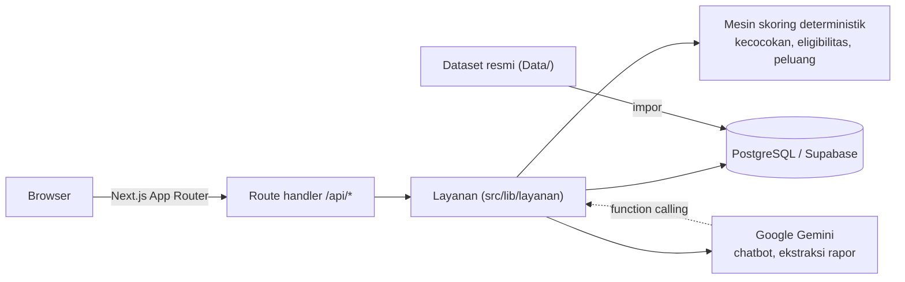

<div align="center">

# Cocokin!

**Cari yang cocok, uji rasanya, tembus kampus impianmu.**

Platform pemilihan jurusan dan estimasi peluang masuk PTN untuk siswa SMA/SMK/MA kelas 12,
berbasis data resmi seleksi nasional.


</div>

---

## Daftar Isi

- [Tentang](#tentang)
- [Fitur Utama](#fitur-utama)
- [Prinsip Desain](#prinsip-desain)
- [Arsitektur](#arsitektur)
- [Teknologi](#teknologi)
- [Memulai](#memulai)
- [Struktur Proyek](#struktur-proyek)
- [API](#api)
- [Data Dan Metodologi](#data-dan-metodologi)
- [Privasi Dan Keamanan](#privasi-dan-keamanan)
- [Dokumentasi](#dokumentasi)
- [Batasan](#batasan)
- [Atribusi](#atribusi)

## Tentang

Setiap tahun, ratusan ribu siswa kelas 12 harus memilih jurusan dan kampus dengan dua pertanyaan besar:

> **"Apakah aku bisa lolos?"** dan **"Apakah aku bakal nyesel?"**

Cocokin! menjawab keduanya dalam satu alur:

1. **Kecocokan minat** — kuis minat berbasis O*NET Interest Profiler (RIASEC) dicocokkan dengan profil
   5.150 program studi di 146 PTN.
2. **Estimasi peluang** — peluang lolos SNBP dan SNBT dihitung dari data resmi snpmb.id dan PDDikti:
   daya tampung, peminat, kuota sekolah, nilai rapor, dan skor tryout.
3. **Simulasi** — studi kasus singkat untuk merasakan cara berpikir mahasiswa di prodi tersebut
   sebelum memutuskan.

Cocokin! dikembangkan untuk Hackathon JOINTS UGM 2026.

## Fitur Utama

| Fitur | Deskripsi |
| --- | --- |
| **Login Google** | Masuk dengan akun Google; sesi aman 30 hari. |
| **Banyak preferensi** | Simpan beberapa skenario (mis. "SNBP Teknik", "SNBT Kesehatan"); satu preferensi aktif dipakai di seluruh aplikasi. |
| **Kuis minat RIASEC** | 30 item resmi O*NET (mode lengkap 60 item) dalam Bahasa Indonesia, menghasilkan kode Holland. |
| **Bahan SNBP** | Pencarian sekolah lewat NPSN/nama (akreditasi, kuota eligible), nilai rapor semester 1–5, peringkat paralel, nilai TKA, dan prestasi. |
| **Unggah rapor** | Foto atau PDF rapor dibaca AI; nilai wajib dikonfirmasi siswa dan berkas tidak disimpan. |
| **Bahan SNBT** | Riwayat skor tryout untuk 7 subtes beserta grafik perkembangannya. |
| **Rekomendasi** | Tiga kartu: *Dream Goal*, *Safety Net* serumpun, dan *Alternatif* — lengkap dengan kecocokan, rentang peluang, dan alasan berbasis data. |
| **Chatbot** | Asisten berbasis Gemini dengan *function calling* ke API internal; setiap angka diverifikasi terhadap data. |
| **Katalog prodi** | Pencarian 5.150 prodi dengan alias (mis. `TI UI`), filter rumpun, jenjang, klaster, dan provinsi. |
| **Simulasi** | Soal studi kasus per prodi, pembahasan, kompetensi lulusan resmi, serta fakta kampus dan persaingan. |
| **Responsif** | Tampilan mobile dan desktop berganti otomatis mengikuti lebar layar. |

## Prinsip Desain

- **Deterministik, bukan tebakan AI.** Seluruh skor kecocokan dan peluang dihitung oleh fungsi murni
  yang teruji. AI hanya membantu mengekstraksi data dan menjelaskan hasil; AI tidak pernah menentukan angka.
- **Transparan terhadap sumber.** Setiap angka membawa label `resmi`, `estimasi`, atau `sintetis`,
  dan estimasi ditampilkan sebagai rentang, bukan angka tunggal.
- **Patuh aturan seleksi 2026.** Aturan SNBP/SNBT (eligibilitas, batas provinsi, mapel pendukung,
  portofolio) dibaca dari konfigurasi, bukan ditanam di kode.

## Arsitektur



- Route handler tipis; logika bisnis ada di `src/lib/layanan`, akses data di `src/lib/db`.
- Akses database hanya dari server (service role); kunci API tidak pernah dikirim ke browser.
- Detail lengkap: [`docs/ARSITEKTUR.md`](docs/ARSITEKTUR.md).

## Teknologi

| Lapisan | Teknologi |
| --- | --- |
| Framework | Next.js 15 (App Router, Turbopack), React 19, TypeScript |
| Styling | Tailwind CSS 4, tema pixel 8-bit |
| Autentikasi | NextAuth 4 (Google OAuth, sesi JWT) |
| Basis data | PostgreSQL (Supabase), `@supabase/supabase-js` |
| AI | Google Gemini Flash-Lite via `@google/genai` |
| Pengujian | Vitest, jsdom |
| Hosting | Vercel |

## Memulai

### Prasyarat

- Node.js 20 atau 22
- Proyek Supabase (PostgreSQL)
- Kredensial Google OAuth (Google Cloud Console)
- Kunci API Gemini dari Google AI Studio (opsional; tanpa kunci, chatbot memakai jawaban cadangan)
- Python 3 dan `psql` (hanya untuk mengimpor dataset)

### Instalasi

```bash
git clone https://github.com/Daliondroid/FajarWasHere-Joints.git cocokin
cd cocokin
npm ci
```

### Konfigurasi

Salin `.env.example` menjadi `.env`, lalu isi nilainya:

| Variabel | Wajib | Keterangan |
| --- | --- | --- |
| `NEXTAUTH_URL` | Ya | URL aplikasi, mis. `http://localhost:3000` |
| `NEXTAUTH_SECRET` | Ya | String acak, mis. hasil `openssl rand -base64 32` |
| `GOOGLE_CLIENT_ID` | Ya | Client ID OAuth Google |
| `GOOGLE_CLIENT_SECRET` | Ya | Client secret OAuth Google |
| `NEXT_PUBLIC_SUPABASE_URL` | Ya | URL proyek Supabase |
| `SUPABASE_SERVICE_ROLE_KEY` | Ya | Kunci service role (hanya server; jangan diberi awalan `NEXT_PUBLIC_`) |
| `GEMINI_API_KEY` | Tidak | Mengaktifkan chatbot AI dan ekstraksi rapor |
| `GEMINI_MODEL` | Tidak | Daftar model Gemini dipisah koma, dipakai bergantian bila kuota habis |
| `SUPABASE_DB_URL` | Impor saja | Koneksi Postgres langsung untuk `scripts/impor_data.py` |

Daftarkan `http://localhost:3000/api/auth/callback/google` sebagai *Authorized redirect URI* di klien OAuth Google.

### Menyiapkan Basis Data

1. Terapkan migrasi di [`supabase/migrations/`](supabase/migrations/) secara berurutan
   (SQL Editor Supabase atau Supabase CLI).
2. Ubah dataset menjadi CSV per tabel, lalu muat ke database:

   ```bash
   python scripts/impor_data.py            # hasil di build/impor/
   cd build/impor && psql "$SUPABASE_DB_URL" -f muat.sql
   ```

3. Jalankan `psql "$SUPABASE_DB_URL" -f scripts/tinjau_soal_demo.sql` untuk menerapkan perbaikan soal demo.

Panduan lengkap, termasuk alternatif Docker: [`scripts/README.md`](scripts/README.md).

### Menjalankan

```bash
npm run dev
```

Buka [http://localhost:3000](http://localhost:3000).

### Perintah Lain

| Perintah | Fungsi |
| --- | --- |
| `npm run dev` | Server pengembangan (Turbopack) |
| `npm run build` | Build produksi |
| `npm start` | Menjalankan hasil build |
| `npm test` | Menjalankan seluruh unit test |
| `npm run test:watch` | Unit test dalam mode pantau |
| `npm run lint` | Pemeriksaan ESLint |

## Struktur Proyek

```text
├── Data/                  Dataset sumber (hanya dibaca) dan kode referensi skoring
├── docs/                  PRD, arsitektur, design system, laporan QA
├── public/                Aset statis
├── scripts/               Skrip impor dan pemeliharaan data
├── supabase/migrations/   Migrasi skema PostgreSQL
├── src/
│   ├── app/               Halaman (App Router) dan route handler /api/*
│   ├── components/        Komponen UI
│   ├── lib/
│   │   ├── skoring/       Mesin skoring murni (kecocokan, eligibilitas, peluang)
│   │   ├── layanan/       Logika bisnis per fitur
│   │   ├── db/            Akses Supabase
│   │   ├── auth/          Konfigurasi NextAuth
│   │   ├── chat/          Chatbot Gemini dan function calling
│   │   ├── rapor/         Ekstraksi rapor
│   │   └── klien/         Klien API untuk browser
│   ├── types/             Tipe kontrak API bersama
│   └── middleware.ts      Gerbang login halaman privat
└── tests/                 Unit test dan skenario QA
```

## API

Seluruh endpoint memakai JSON `snake_case` dan format galat seragam
`{ "error": { "kode": "...", "pesan": "..." } }`.

| Endpoint | Fungsi |
| --- | --- |
| `GET /api/school` | Cari sekolah berdasarkan NPSN atau nama |
| `GET /api/prodi`, `GET /api/prodi/[id_prodi]` | Katalog dan detail prodi |
| `POST /api/kecocokan` | Skor kecocokan minat RIASEC |
| `POST /api/peluang` | Estimasi peluang SNBP/SNBT |
| `GET /api/rekomendasi` | Tiga kartu rekomendasi dari preferensi aktif |
| `/api/preferensi/*` | Kelola banyak preferensi dan preferensi aktif |
| `GET /api/test-drive`, `POST /api/test-drive/jawab` | Soal dan pemeriksaan jawaban Simulasi |
| `POST /api/rapor/ekstrak` | Ekstraksi nilai dari foto/PDF rapor |
| `/api/chat` | Kirim pesan, ambil, dan hapus riwayat chatbot |
| `/api/akun`, `/api/auth/*` | Status akun, hapus akun, dan login |

Kontrak lengkap beserta bentuk masukan dan keluaran: [`docs/ARSITEKTUR.md`](docs/ARSITEKTUR.md#4-kontrak-api)
dan [`src/types/api.ts`](src/types/api.ts).

## Data Dan Metodologi

| Kategori | Sumber | Isi |
| --- | --- | --- |
| Resmi | snpmb.id | Prodi, daya tampung, peminat, diterima, kuota sekolah SNBP 2026 |
| Resmi | PDDikti Kemdiktisaintek | Akreditasi, profil, dan kompetensi lulusan prodi |
| Resmi | Kepmendikdasmen 102/M/2025 | Mapel pendukung per prodi |
| Instrumen | O*NET Interest Profiler | Item minat RIASEC, diterjemahkan ke Bahasa Indonesia |
| Estimasi | Olahan tim | Skor UTBK per prodi (selalu diberi label estimasi) |

Ringkasan metode:

- **Kecocokan** = kemiripan (korelasi Pearson) profil RIASEC siswa dengan profil prodi, dipadukan dengan
  sinyal hobi; mapel favorit menjadi pemecah seri.
- **Keketatan** = rasio diterima ÷ peminat; prodi tanpa histori memakai rata-rata rumpun di PTN yang sama
  dan diberi label *data terbatas*.
- **Peluang SNBP** memadukan nilai rapor, peringkat paralel, TKA, prestasi, dan kuota sekolah,
  dengan aturan satu provinsi untuk dua pilihan pertama.
- **Peluang SNBT** membandingkan skor tryout dengan estimasi skor prodi.

Parameter asumsi didokumentasikan di [`src/lib/skoring/parameter_estimasi.json`](src/lib/skoring/parameter_estimasi.json),
implementasi rujukan di [`Data/kode/skoring_referensi.py`](Data/kode/skoring_referensi.py), dan audit dataset di
[`Data/AUDIT_DATA.md`](Data/AUDIT_DATA.md).

## Privasi Dan Keamanan

- Berkas rapor yang diunggah hanya diproses dan tidak disimpan.
- Nama dan email pengguna tidak dikirim ke layanan AI.
- Pengguna dapat menghapus akun beserta seluruh preferensi dan riwayatnya kapan saja.
- Basis data hanya diakses dari server; tabel dilindungi Row Level Security.
- Rahasia hanya disimpan di variabel lingkungan, tidak pernah di repositori.

## Dokumentasi

| Dokumen | Isi |
| --- | --- |
| [`docs/PRD.md`](docs/PRD.md) | Kebutuhan produk: fitur, aturan bisnis, alur pengguna |
| [`docs/ARSITEKTUR.md`](docs/ARSITEKTUR.md) | Arsitektur, kontrak API, konvensi, strategi test |
| [`docs/DESIGN_SYSTEM.md`](docs/DESIGN_SYSTEM.md) | Token visual, tipografi, dan komponen |
| [`docs/QA_SOAL_DEMO.md`](docs/QA_SOAL_DEMO.md) | Laporan QA skenario siswa dan soal demo |
| [`Data/README.md`](Data/README.md) | Penjelasan dataset |

## Batasan

- Hasil estimasi **bukan jaminan kelulusan**; keputusan akhir ada pada panitia seleksi nasional.
- Cakupan jalur: SNBP dan SNBT. Jalur Mandiri dan informasi UKT belum didukung.
- Estimasi skor UTBK per prodi bukan data resmi dan selalu ditandai sebagai estimasi.

## Atribusi

- Instrumen minat dari [O*NET Resource Center](https://www.onetcenter.org/) (CC BY 4.0), diterjemahkan dan diadaptasi.
- Koordinat lokasi dari OpenStreetMap Nominatim (© OpenStreetMap contributors, ODbL).
- Data seleksi dari [snpmb.id](https://snpmb.id) dan [PDDikti Kemdiktisaintek](https://pddikti.kemdiktisaintek.go.id).

---

<div align="center">
Dikembangkan untuk <strong>Hackathon JOINTS UGM 2026</strong>.
</div>
