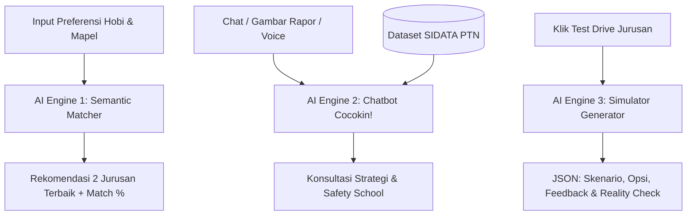

# Product Requirements Document (PRD) — Cocokin! 🎮🎓
**Platform Cek Kecocokan Jurusan, Prediksi Peluang PTN & Simulator Test Drive Interaktif**
*Tema: Education · Subtema: Siswa SMA Kelas Akhir (Menentukan Jurusan, Memilih Jalur Pendidikan & Merencanakan Karir)*
*Dokumen Spesifikasi Teknis & Desain · Versi 2.0 (Revisi Final Hackathon JOINTS UGM 2026)*

---

## 1. Ringkasan Eksekutif & Identitas Produk

| Parameter | Spesifikasi |
| :--- | :--- |
| **Nama Produk** | **Cocokin!** |
| **Tagline** | *"Cari yang Cocok, Uji Rasanya, Tembus Kampus Impianmu!"* |
| **Target Pengguna** | Siswa SMA/SMK/MA kelas 12, pejuang SNBP & SNBT, serta guru BK |
| **Gaya Desain Visual** | **Retro Pixel 8-Bit Arcade / RPG** dipadukan dengan **Google Color Palette** yang ramah, vibrant, dan berjiwa muda |
| **Inti Nilai (Core Value)** | Menjawab 2 ketakutan terbesar anak SMA: *"Apakah aku bisa lolos?"* (Peluang Kuota & Keketatan) dan *"Apakah aku bakal nyesel?"* (Kecocokan Minat & Test Drive Rasa Kuliah) |
| **Tech Stack Utama** | Next.js 15 (App Router, TypeScript), Tailwind CSS, Google Gemini 1.5 Flash API (Google AI Studio), Dataset SIDATA PTN Kemendikbud & NPSN Dapodik lokal |

---

## 2. Masalah & Latar Belakang (Hook Lomba)

1. **Tragedi Salah Jurusan:** Data riset *Indonesia Career Center Network (ICCN)* mengungkap bahwa **87% mahasiswa Indonesia merasa salah jurusan**. Akibatnya: IPK anjlok, depresi, hingga *drop-out* di tahun ke-2.
2. **Aturan "One-Way Ticket" SNBP 2026:** Regulasi resmi Kemendikbud menetapkan bahwa siswa yang dinyatakan lolos SNBP **TIDAK BISA** mendaftar SNBT maupun Jalur Mandiri di seluruh PTN. Salah memilih berarti terjebak selamanya.
3. **Keterbatasan Solusi yang Ada di Pasar:**
   - *Kalkulator SNBP biasa:* Hanya menghitung angka tanpa peduli apakah siswa bahagia di jurusan tersebut.
   - *Tes Minat Bakat biasa:* Hanya memberi label kepribadian tanpa tahu realitas kuota dan persaingan kampus.
   - *Ketiadaan Preview Perkuliahan:* Siswa memilih jurusan murni dari nama keren dan brosur, tanpa pernah tahu tugas dan mata kuliah aslinya.
4. **Solusi Cocokin!:** Menghadirkan **Dual-Engine System**:
   - **Engine 1: Test Drive 60 Detik** (Merasakan langsung studi kasus mata kuliah nyata).
   - **Engine 2: Admission Matcher** (Menghitung peluang berbasis data resmi SIDATA PTN se-Indonesia, bobot akreditasi NPSN, kedekatan alamat provinsi, dan rekam jejak alumni).

---

## 3. Design System: 8-Bit Pixel x Google Color Palette

### 3.1. Color Palette (Google Retro Spectrum)
- 🔵 **Google Blue (`#4285F4`):** Warna primer untuk tombol aksi utama (*Next*, *Mulai*, *Search*), link navigasi, dan elemen SAINTEK.
- 🔴 **Google Red (`#EA4335`):** Warna peringatan penalti/blacklist alumni, tombol bahaya (*Back*, *Batal*), dan status *High Risk*.
- 🟡 **Google Yellow (`#FBBC05`):** Warna lencana prestasi, bintang rekomendasi, peringatan *Moderate Risk*, dan aksen gold.
- 🟢 **Google Green (`#34A853`):** Warna status *Safe/Aman*, tombol konfirmasi, dan elemen SOSHUM.
- ⬛ **Pixel Borders & Shadow:** `#1A1A1A` dengan `border: 3px solid #1A1A1A` dan `box-shadow: 4px 4px 0px #1A1A1A`.
- ⚪ **Background Surfaces:** Retro Canvas Off-White (`#F8F9FA` light mode) dan Retro Slate Dark (`#202124` dark mode).

### 3.2. Tipografi
- **Headings & Badges:** *'Press Start 2P'* atau *'Silkscreen'* (Monospace retro pixel font).
- **Body & Teks Panjang:** *'Outfit'* atau *'Inter'* dengan rendering crisp font-weight 500-600 agar mudah dibaca oleh siswa SMA.

---

## 4. Spesifikasi 13 Halaman (1-to-1 Mapping dengan Low Fidelity.jpeg)

```
[1. Beranda Hero] ──scroll──> [2. CTA Orang 8-Bit: 'Isi Preferensi Dulu Yu']
                                         │
                        [Klik 'Mulai']   ▼
                        ┌────────────────────────────────────────────────────────┐
                        │ 🔐 AUTH GATE: Cek Status Login Google (Gmail)          │
                        ├────────────────────────────────────────────────────────┤
                        │ • Belum Login  ──> Modal Login Google (Gmail OAuth)    │
                        │ • Sudah Login & Belum Isi ──> [3. Preferensi: Minat]   │
                        │ • Sudah Login & Sudah Isi ──> Langsung loncat ke [8]!  │
                        └────────────────────────────────────────────────────────┘
                                         │
                                         ▼
[3. Preferensi: Hobi & Minat] ──> [4. Preferensi: Check Jalur SNBP/SNBT]
                                           │
                                           ▼
[5. Bahan SNBP: Rapor & NPSN] ──> [6. Alamat & Reputasi Alumni] ──> [7. Blacklist & Input SNBT TO]
                                                                                │
                                                                                ▼
[11. Drawer Option] <── [10. Chatbot Cocokin!] <── [9. Banner Chat] <── [8. Halaman Cocokin (Hasil)]
         │                                                                      │
         ▼                                                                      ▼
[12. Katalog Test Drive] ──────────────────────────────────────────> [13. Detail Mini Challenge]
```

> **⚡ Smart Routing & Long-Lived Session:**
> Jika user sudah login dan **sudah pernah mengisi preferensi sebelumnya**, saat berada di Beranda (1) dan men-scroll ke bawah melewati Hero, sistem **otomatis langsung mengarahkan ke Halaman 8 (Cocokin)** tanpa mengulang form preferensi!

---

### Halaman 1: Beranda (Hero Section)
* **Navbar Atas:**
  - Kiri: Logo Pixel **Cocokin!** dengan ikon dadu/gamepad 8-bit.
  - Kanan: Menu Navigasi `[Beranda]` `[Cocokin]` `[Edit Preferensi]` `[Login / Logout]`.
* **Hero Content:**
  - **Teks Headline (Hook):** *"87% Mahasiswa Merasa Salah Jurusan. Jangan Sampai Giliranmu!"*
  - **Sub-headline:** *"Uji rasa kuliahmu dalam 60 detik, cocokkan minat, dan hitung peluang tembus PTN impianmu lewat data resmi Kemendikbud."*
  - **Hero Art:** Ilustrasi pemandangan kampus impian bergaya pixel 8-bit (gedung universitas ikonik Indonesia).
  - **Scroll Indicator:** Arrow pixel ke bawah berkedip dengan tulisan *"Jelajahi ↓"*.

---

### Halaman 2: Ajakan Onboarding & Google Auth Gate (CTA Section)
* Tampilan transisi dengan ilustrasi karakter siswa pixel 8-bit melambaikan tangan.
* **Teks Dialog Balon:** *"Isi preferensi dulu yuu, biar ramalan Cocokin! makin akurat!"*
* **Tombol Aksi:** Tombol pixel besar `[ MULAI SEKARANG ▶ ]` (Warna Google Green `#34A853`, efek pressed 3D).
* **Mekanisme Logika Autentikasi (Google OAuth Gate):**
  1. **Jika Siswa Belum Login:**
     - Muncul modal pop-up 8-bit: *"Masuk atau Daftar dengan Akun Google (Gmail) untuk Menyimpan Hasil Ramalan & Progresmu"*.
     - Tombol resmi: `[ 🔴 G | Lanjutkan dengan Google ]`.
     - Begitu otentikasi Google sukses: sistem otomatis meneruskan siswa ke **Halaman 3 (Form Minat & Hobi)**.
  2. **Jika Siswa Sudah Login & Sudah Ada Data Preferensi:**
     - Sistem langsung melakukan *smooth bypass*: tombol 'Mulai' atau scroll dari Beranda langsung membukakan **Halaman 8 (Halaman Cocokin / Hasil Rekomendasi)**.
  3. **Manajemen Sesi Jangka Panjang (Long-Lived Session):**
     - Sesi login disimpan menggunakan **Secure HttpOnly Cookie / NextAuth Token dengan masa aktif 30 Hari**.
     - Siswa tidak perlu berulang kali login setiap kali membuka browser. Status preferensi tetap tersimpan permanen di profil akun.

---

### Halaman 3: Wizard Preferensi — Hobi & Minat
* **Progress Bar Atas:** Indikator bertahap: `[1. Minat (Aktif)]` ────── `[2. Bahan]`
* **Judul & Teks Instruksi:**
  - *"Apa hobi & minatmu?"*
  - *"Pilih hal-hal yang bikin kamu lupa waktu saat mengerjakannya:"*
* **8 Sample Badges (Interactive Toggle Chips 8-Bit):**
  1. `[💻 Ngoprek Kode & Gadget]`
  2. `[🎨 Gambar & Desain Visual]`
  3. `[💼 Jualan & Rintis Bisnis]`
  4. `[🔬 Eksperimen Sains & Riset]`
  5. `[⚖️ Debat & Analisis Hukum]`
  6. `[✍️ Menulis Cerita & Konten]`
  7. `[🩺 Peduli Kesehatan & Medis]`
  8. `[🌿 Lingkungan & Sosial]`
* **Kolom Input Bebas (Textarea):**
  - Placeholder: *"Masukan hobi & minat mu di luar sampel di atas sejelas-jelasnya... (Contoh: Suka merakit PC gaming, suka analisis strategi video game, benci hafalan biologi)"*.
* **Tombol Kontrol Bawah:**
  - Kiri: `[ ◀ Kembali ]` (Abu-abu retro).
  - Kanan: `[ Selanjutnya ▶ ]` (Google Blue `#4285F4`).

---

### Halaman 4: Wizard Preferensi — Pemilihan Jalur Evaluasi
* **Progress Bar:** Posisi berada di `[2. Bahan (Aktif)]`.
* **Instruksi:** *"Pilih jalur seleksi yang ingin kamu evaluasi peluangnya:"*
* **Checkbox Jalur Interaktif:**
  - `[✓] SNBP (Seleksi Nasional Berdasarkan Prestasi - Nilai Rapor & Sekolah)`
  - `[✓] SNBT (Seleksi Nasional Berdasarkan Tes - UTBK & Portofolio)`
* *Catatan Logika:* Siswa bisa mencentang salah satu atau keduanya sekaligus. Form di halaman 5–7 akan beradaptasi secara dinamis.
* **Tombol Kontrol:** `[ ◀ Kembali ]` dan `[ Selanjutnya ▶ ]`.

---

### Halaman 5: Formulir Bahan SNBP — Data Akademik & NPSN
* **Upload / Input Rapor:**
  - Pilihan input cepat: Rata-rata nilai rapor semester 1–5 (atau upload foto/PDF rapor untuk diekstrak AI).
  - Input perkiraan peringkat paralel di sekolah (misal: ranking 12 dari 120 siswa jurusan IPA).
* **Cek NPSN Sekolah (The Auto-Lookup Feature):**
  - Kolom input: 8 Digit Nomor Pokok Sekolah Nasional (NPSN) atau ketik Nama Sekolah.
  - *Trigger:* Begitu diisi, sistem otomatis mengambil data Dapodik Pusdatin:
    - **Nama Resmi Sekolah:** Terisi otomatis.
    - **Akreditasi Sekolah:** Terkunci otomatis (`A`, `B`, atau `C`).
    - **Status Kuota Eligible:** Otomatis menampilkan kuota resmi (`Akreditasi A: Kuota 40% Siswa Terbaik`).
* **Upload Sertifikat & Portofolio:**
  - Slot upload prestasi non-akademik (Tingkat: Kota, Provinsi, Nasional, Internasional + Bidang: Juara Lomba, OSN, FLS2N, dll.).

---

### Halaman 6: Formulir Bahan SNBP — Alamat & Reputasi Alumni
* **Alamat Siswa (Geolokasi & Aturan 1 Provinsi):**
  - Pilihan Provinsi & Kabupaten/Kota domisili sekolah/siswa.
  - *Fungsi Sistem:* Memvalidasi aturan resmi SNBP (jika memilih 2 prodi, salah satu PTN wajib berada di provinsi yang sama dengan sekolah asal).
* **Reputasi Guild Alumni (School Alumni Track Record):**
  - Pilihan Radio Button 8-bit:
    - 👑 `[Langganan Banjir PTN Top]` (Rutin lolos banyak siswa ke UGM/ITB/UI per tahun).
    - ⚔️ `[Rutin Lolos PTN Negeri]` (Konsisten tembus prodi negeri 10–30 orang/tahun).
    - 🛡️ `[Lolos 1-5 Siswa / Tahun]` (Hanya segelintir yang tembus per tahun).
    - 🌲 `[Sekolah Baru / Belum Ada Jejak]` (Mode Perintis: butuh nilai rapor lebih dominan).
  - **Kampus Basis Utama Alumni (Multi-Select Tags):**
    - `[ + UGM ]` `[ + ITB ]` `[ + UI ]` `[ + UNAIR ]` `[ + ITS ]` `[ + UNDIP ]` `[ + Tambah Kampus Lain ]`.

---

### Halaman 7: Formulir SNBP Blacklist & Bahan SNBT (Try Out)
* **Status Kutukan Penalti Alumni (Blacklist Check):**
  - Pertanyaan: *"Apakah ada riwayat alumni sekolahmu yang diterima SNBP tetapi TIDAK DIAMBIL / TIDAK DAFTAR ULANG?"*
  - Opsi: `[ 🟢 Aman / Tidak Pernah ]` atau `[ 💀 Pernah ]`.
  - Jika memilih *"Pernah"*, muncul kolom isian: *"Sebutkan di kampus mana?"* (Sistem mengaktifkan penalti indeks sekolah untuk kampus bersangkutan).
* **Bahan SNBT (Jika Jalur SNBT Dicentang):**
  - **Input Nilai Try Out (7 Subtes Resmi UTBK):**
    1. Penalaran Umum (PU)
    2. Pengetahuan & Pemahaman Umum (PPU)
    3. Pemahaman Bacaan dan Menulis (PBM)
    4. Pengetahuan Kuantitatif (PK)
    5. Literasi dalam Bahasa Indonesia
    6. Literasi dalam Bahasa Inggris
    7. Penalaran Matematika (PM)
  - **Fitur History TO:** Tombol `[ ➕ Tambah Riwayat TO Lainnya ]` (Siswa bisa memasukkan riwayat TO ke-1, ke-2, ke-3 untuk melihat grafik kenaikan skor).
  - **Upload Portofolio Khusus:** Wajib untuk jurusan rumpun Seni (Musik, Rupa, Tari) dan Olahraga.
* **Tombol Kontrol Bawah:** `[ ◀ Kembali ]` dan `[ ✨ Selesai & Cocokkan! ]`.

---

### Halaman 8: Halaman Cocokin (Dashboard Rekomendasi Utama)
* **Header Hasil:** Teks retro *"HASIL REKOMENDASI JURUSAN & KAMPUSMU"*.
* **2 Kartu Rekomendasi Terbaik (Sesuai Aturan Kuota SNBP):**
  - **Kartu 1 (The Dream Goal - Pilihan 1):**
    - Nama Jurusan (misal: *Teknologi Informasi*).
    - Badge Rumpun (*SAINTEK*).
    - **Persentase Kecocokan Minat:** `[██████████░] 94% Match`.
    - **Peluang Kelolosan Kampus Rekomendasi:**
      - UGM (Keketatan 2.38% — Kategori: 🟡 *Waspada / Butuh Usaha*)
      - UNY (Keketatan 4.70% — Kategori: 🟢 *Aman*)
  - **Kartu 2 (The Safety Net - Pilihan 2 Serumpun):**
    - Nama Jurusan (misal: *Sistem Informasi*).
    - **Persentase Kecocokan Minat:** `[████████░░░] 86% Match`.
    - **Peluang Kelolosan Kampus:**
      - UPN Veteran Yogyakarta (Keketatan 9.67% — Kategori: 🟢 *Sangat Aman*)
* **Banner Jembatan ke Test Drive:**
  - Teks: *"Mau kenal dan rasakan studi kasus mata kuliahnya sebelum memilih?"*
  - Tombol Pixel: `[ 🎮 Test Drive Jurusan Ini ▶ ]`.

---

### Halaman 9: Banner Konsultasi Interaktif
* Elemen pembatas di bawah rekomendasi:
* Teks Headline: *"Beri Tahu Kami Jurusan & Kampus Apa yang Kamu Incar!"*
* Ilustrasi karakter 8-bit mengedipkan mata di sebelah chat bubble.
* Tombol CTA: `[ 💬 Di Chat yuu ▶ ]` (Membawa siswa langsung ke ruang konsultasi chatbot Cocokin!).

---

### Halaman 10: Halaman Chatbot Interaktif ("Cocokin!")
* **Header Chat:**
  - Tombol `[ ◀ ]` kembali ke halaman Cocokin.
  - Teks Sapaan Personal: *"Hai, [Nama Siswa]! Aku Cocokin!, mentor strategimu."*
  - Tombol Kanan: `[ ≡ Opsi ]` (Membuka drawer Nomor 11).
* **3 Rekomendasi Quick-Prompt (Interactive Chips):**
  1. *"Jurusan dan kampus mana ya yang paling aman untuk nilai SNBP saya?"*
  2. *"Bandingkan Informatika ITB dan ITS, lebih besar peluang lolos di mana untuk SNBT?"*
  3. *"Kalau saya benci kalkulus, apakah bertahan di jurusan Rekayasa Perangkat Lunak?"*
* **Area Pesan Chat (Chat Bubble 8-Bit):**
  - Pesan otomatis pertama dari AI langsung merangkum analisis profil siswa.
  - Mendukung markdown format, tabel perbandingan kampus, dan tag peluang.
* **Kolom Input Multifungsi di Bawah:**
  - Tombol `[ ➕ ]` (Upload file gambar sertifikat, scan nilai rapor, atau silabus PDF).
  - Kolom teks: *"Tanyakan apapun tentang prodi dan strategi kampus..."*.
  - Tombol `[ 🎙️ ]` (Voice input/speech recognition untuk anak SMA yang malas mengetik).
  - Tombol Kirim pixel `[ ➔ ]`.

---

### Halaman 11: Drawer / Modal Menu Chatbot
* Muncul saat tombol option `[ ≡ ]` di halaman chatbot diklik.
* **Daftar Pilihan Menu (Navigasi Terstruktur):**
  1. `[ 🎮 Test Drive Jurusan ]` (Navigasi langsung ke arena katalog simulasi jurusan).
  2. `[ ✏️ Edit Preferensi ]` (Navigasi kembali ke form wizard jika ingin memperbarui nilai rapor, TO, atau minat bakat).
  3. `[ 📜 Riwayat Chat Sebelumnya ]` (Melihat arsip tanya-jawab yang pernah dilakukan bersama chatbot Cocokin!).
  4. `[ 🚪 Keluar / Logout ]` (Mengakhiri sesi akun Google).

---

### Halaman 12: Halaman Katalog Test Drive Jurusan (5.150 Prodi Se-Indonesia)
* **Cakupan Data Lengkap:**
  - Menampilkan dan mengindeks **seluruh 5.150 Program Studi / Jurusan resmi** dari 145 PTN, Politeknik Negeri, dan PTKIN di seluruh Indonesia (berdasarkan dataset resmi SIDATA SNPMB).
* **Header Navigasi & Pencarian:**
  - Tombol `[ ◀ ]` kembali ke Cocokin.
  - **Instant Search Bar 8-Bit:** Siswa dapat mengetik nama prodi apa pun dari 5.150 jurusan (misal: *Teknologi Rekayasa Perangkat Lunak, Teknik Nuklir, Akuakultur, Aktuaria, Desain Komunikasi Visual, Sastra Rusia, Rekayasa Nanoteknologi, dll.*) dengan hasil pencarian instan (*fuzzy search*).
* **Filter Navigasi Cepat (Google Colors):**
  - Filter Rumpun: `[ 🔵 SAINTEK / IPA ]` dan `[ 🟢 SOSHUM / IPS ]`.
  - Filter Jenjang: `[ Semua ]` `[ S1 ]` `[ D4 / Sarjana Terapan ]` `[ D3 ]`.
  - Filter Rumpun Induk (Kategori Disiplin): *Teknologi & Komputer, Rekayasa/Teknik, Kesehatan & Medis, Bisnis & Manajemen, Sosial & Humaniora, Sains & MIPA, Pertanian & Maritim, Seni & Desain*.
* **Tampilan List / Grid Kartu Prodi (High-Performance Virtualized List):**
  - Masing-masing kartu prodi 8-bit menampilkan:
    - Nama Lengkap Program Studi (contoh: *Teknologi Rekayasa Perangkat Lunak*).
    - Nama PTN Penyelenggara (contoh: *Sekolah Vokasi UGM*).
    - Badge Jenjang & Rumpun (contoh: `D4` | `SAINTEK`).
    - Tombol Pixel Interaktif: `[ 🎮 Test Drive Jurusan Ini ▶ ]`.

---

### Halaman 13: Halaman Detail Test Drive (Mini Challenge 5.150 Prodi)
* **Header:** Tombol `[ ◀ Kembali ke Katalog ]`, Nama Jurusan & Kampus (contoh: *Teknologi Rekayasa Perangkat Lunak - Sekolah Vokasi UGM*).
* **Badge Hook:** *"Yuk rasakan cara berpikir mahasiswa [Nama Prodi] selama 60 detik!"*
* **On-the-Fly Generation by Gemini 1.5 Flash:**
  - Begitu kartu prodi diklik, Gemini API langsung memproses nama prodi spesifik tersebut dan menghasilkan mini-challenge yang akurat dengan keilmuan prodi bersangkutan:
* **Komponen Mini Challenge:**
  - **Skenario Masalah Nyata:** Studi kasus 60 detik yang merefleksikan persoalan autentik di prodi tersebut (misal untuk TRPL: *debugging error logic program*; untuk Farmasi: *interaksi dosis obat*; untuk Hukum: *analisis wanprestasi vs pidana*).
  - **Snippet Visual:** Blok kode sederhana, pasal hukum, grafik data, atau bagan logika 8-bit.
  - **Pertanyaan Pilihan Ganda:** 3 Opsi interaktif [A], [B], [C].
* **Komponen Setelah Siswa Memilih Jawaban (Instant Reveal):**
  - **Feedback Instan:** Penjelasan lugas mengapa opsi tersebut benar/salah secara logika keilmuan.
  - **Reality Check (Kenyataan Kuliah):**
    - Kutipan realita: Apa yang sebenarnya dipelajari di kampus (bukan sekadar asumsi luar).
    - **Mata Kuliah Asli:** 2–3 nama mata kuliah nyata yang wajib dipelajari di prodi tersebut.
    - **Tantangan Nyata (Warning):** Fakta keras / tantangan terberat kuliah di prodi itu agar siswa tidak kaget setelah masuk.

---

## 5. Taksonomi & Arsitektur Indeks 5.150 Prodi di Test Drive

Sistem mengindeks **5.150 Program Studi resmi se-Indonesia** yang dipetakan ke dalam 8 Klaster Rumpun Induk untuk memudahkan penjelajahan dan pencarian:

```
👾 INDEKS 5.150 PROGRAM STUDI INDONESIA (ARENA TEST DRIVE)
├── 💻 1. RUMPUN TEKNOLOGI, KOMPUTER & INFORMATIKA (±420 Prodi)
│   ├── S1 Teknik Informatika, S1 Ilmu Komputer, S1 Sistem Informasi
│   ├── D4 Teknologi Rekayasa Perangkat Lunak, D4 Rekayasa Multimedia
│   └── S1 Sains Data, S1 Kecerdasan Buatan, D4 Animasi & Game, dll.
├── 🏗️ 2. RUMPUN REKAYASA & TEKNIK FISIK (±980 Prodi)
│   ├── S1 Teknik Sipil, S1 Teknik Mesin, S1 Teknik Elektro, S1 Teknik Kimia
│   ├── S1 Teknik Industri, S1 Teknik Biomedis, S1 Arsitektur, S1 Teknik Geologi
│   └── D4 Teknologi Rekayasa Otomasi, D4 Konstruksi Gedung, dll.
├── 🩺 3. RUMPUN KESEHATAN, KEDOKTERAN & FARMASI (±510 Prodi)
│   ├── S1 Pendidikan Dokter, S1 Kedokteran Gigi, S1 Farmasi, S1 Keperawatan
│   └── S1 Gizi, S1 Kebidanan, S1 Kesehatan Masyarakat, D4 Fisioterapi, dll.
├── 💼 4. RUMPUN EKONOMI, BISNIS & MANAJEMEN (±850 Prodi)
│   ├── S1 Manajemen, S1 Akuntansi, S1 Ilmu Ekonomi, S1 Bisnis Digital
│   └── D4 Manajemen Perbankan, S1 Kewirausahaan, D4 Akuntansi Sektor Publik, dll.
├── ⚖️ 5. RUMPUN SOSIAL, HUMANIORA & HUKUM (±920 Prodi)
│   ├── S1 Ilmu Hukum, S1 Psikologi, S1 Hubungan Internasional, S1 Ilmu Komunikasi
│   └── S1 Sosiologi, S1 Ilmu Politik, S1 Antropologi, S1 Sastra (Inggris, Jepang, Arab), dll.
├── 🔬 6. RUMPUN SAINS & MATEMATIKA / MIPA (±480 Prodi)
│   ├── S1 Matematika, S1 Statistika, S1 Fisika, S1 Kimia, S1 Biologi
│   └── S1 Aktuaria, S1 Geofisika, S1 Astronomi, S1 Bioteknologi, dll.
├── 🌾 7. RUMPUN PERTANIAN, PETERNAKAN & KELAUTAN (±640 Prodi)
│   ├── S1 Agroteknologi, S1 Agribisnis, S1 Ilmu Kelautan, S1 Kehutanan
│   └── S1 Peternakan, S1 Teknologi Pangan, D4 Penyuluhan Pertanian, dll.
└── 🎨 8. RUMPUN SENI, DESAIN & KREATIF (±350 Prodi)
    ├── S1 Desain Komunikasi Visual (DKV), S1 Desain Produk, S1 Kriya
    └── S1 Seni Murni, S1 Film & Televisi, S1 Desain Interior, S1 Seni Musik, dll.
```

---

## 6. Spesifikasi Data Layer & Logika Skoring

### 6.1. Dataset yang Disediakan & Diindeks di Aplikasi
1. **`dataset_sidata_ptn.json`:**
   - Sumber: Laman resmi SIDATA PTN SNPMB BPPP Kemendikbudristek.
   - Ruang lingkup: **Lengkap 100% — Seluruh 5.150 Program Studi dari 145 PTN, Politeknik Negeri, dan PTKIN se-Indonesia.**
   - Atribut data per item:
     - `kode_ptn` : string (contoh: `"351"`)
     - `nama_ptn` : string (contoh: `"UNIVERSITAS GADJAH MADA"`)
     - `provinsi_ptn` : string (contoh: `"D.I. Yogyakarta"`)
     - `kode_prodi` : string (contoh: `"351024"`)
     - `nama_prodi` : string (contoh: `"TEKNOLOGI REKAYASA PERANGKAT LUNAK"`)
     - `jenjang` : enum (`"S1"`, `"D4"`, `"D3"`)
     - `rumpun` : enum (`"SAINTEK"`, `"SOSHUM"`)
     - `klaster_keilmuan` : string (kategori 1–8 untuk filter cepat)
     - `daya_tampung_snbp` : number
     - `peminat_snbp_lalu` : number
     - `daya_tampung_snbt` : number
     - `peminat_snbt_lalu` : number
     - `syarat_portofolio` : string (opsional: `"Seni Rupa"`, `"Olahraga"`, atau `"Tidak Ada"`)
2. **`dataset_sekolah_npsn.json`:**
   - Sumber: Basis data Pusdatin Dapodik Kemendikbudristek.
   - Ruang lingkup: SMA, SMK, dan MA se-Indonesia.
   - Atribut: `npsn`, `nama_sekolah`, `kab_kota`, `provinsi`, `akreditasi` (A/B/C), `kuota_eligible_persen`.

### 6.2. Logika Formula Skoring & Aturan Validasi

#### A. Aturan Satu Provinsi (SNBP Compliance Rule):
- Jika siswa memilih 2 prodi SNBP:
  $$\text{Valid} \iff (\text{Provinsi PTN Pilihan 1} = \text{Provinsi Sekolah}) \lor (\text{Provinsi PTN Pilihan 2} = \text{Provinsi Sekolah})$$
  *(Jika siswa memilih kedua PTN di luar provinsinya, sistem memberi badge peringatan merah: "Melanggar aturan zonasi provinsi SNBP!").*

#### B. Perhitungan Rasio Keketatan Riil:
$$\text{Rasio Keketatan (\%)} = \left( \frac{\text{Daya Tampung}}{\text{Jumlah Peminat}} \right) \times 100\%$$
- $\text{Keketatan} < 3\%$ : **Kategori Sangat Ketat (High Risk)**
- $3\% \le \text{Keketatan} \le 8\%$ : **Kategori Kompetitif (Moderate)**
- $\text{Keketatan} > 8\%$ : **Kategori Terbuka / Aman (Safety School)**

#### C. Model Heuristik Peluang Lolos (SNBP Heuristic Index):
$$\text{Indeks Peluang} = \left[ (\text{Skor Rapor} \times 0.45) + (\text{Bobot Prestasi} \times 0.15) \right] \times \text{Multiplier Alumni} \times \text{Multiplier Akreditasi}$$
- **Multiplier Alumni:**
  - Guild Legenda: $1.20$
  - Guild Veteran: $1.10$
  - Guild Penjelajah: $1.00$
  - Guild Perintis: $0.80$
  - Riwayat Blacklist: Penalti $-0.25$
- **Multiplier Akreditasi:**
  - Akreditasi A: $1.10$ | Akreditasi B: $1.00$ | Akreditasi C: $0.85$

---

## 7. Arsitektur AI Engine (Google Gemini 1.5 Flash)

Aplikasi menggunakan **Google Gemini 1.5 Flash API** dengan 3 peran modular:



1. **AI Engine 1 — Semantic Preference Matcher:**
   - Menganalisis korelasi hobi + keunggulan mata pelajaran terhadap taksonomi jurusan perkuliahan.
   - Mengembalikan 2 rekomendasi jurusan dengan *Structured Output (JSON Schema)*.
2. **AI Engine 2 — Chatbot Konsultan "Cocokin!":**
   - Menggunakan `systemInstruction` dengan persona *Kakak Tingkat Mentor yang asyik, gaul, dan jujur (no sugarcoating)*.
   - Mendukung input multimodal: teks, upload gambar sertifikat/rapor, dan transkrip suara.
   - Menghubungkan pertanyaan siswa dengan data kuota resmi kampus.
3. **AI Engine 3 — Dynamic Test Drive Generator:**
   - Men-generate studi kasus 60 detik secara instan jika siswa meminta test drive jurusan langka/spesifik di luar katalog utama.

---

## 8. Rencana Kerja Eksekusi 48 Jam (Sprint UTS Mode)

| Anggota Tim | Peran Utama | Deliverable Konkret |
| :--- | :--- | :--- |
| **Orang 1** | **Frontend Lead** | Implementasi UI 8-bit Pixel (Navbar, Landing Page, Halaman Wizard Preferensi 3–7, dan Katalog Test Drive 12–13). |
| **Orang 2** | **Fullstack & AI Lead** | Setup Next.js API Routes (`/api/school`, `/api/test-drive`, `/api/chat`), integrasi Gemini 1.5 Flash SDK, dan query filtering dataset PTN. |
| **Orang 3** | **UI/UX & Pitch Deck Lead** | Menyempurnakan aset visual pixel 8-bit di Figma, menyusun **Pitch Deck PDF (10 Slide)** lengkap dengan deklarasi penggunaan AI. |
| **Orang 4** | **Data, Video & QA Lead** | Validasi integritas file JSON PTN & NPSN, menyusun script video pitch 2 menit, merekam demo aplikasi, dan upload video ke YouTube. |

---

## 9. Deklarasi Kepatuhan & Transparansi AI (Aturan Hackathon JOINTS)
Sesuai arahan Technical Meeting JOINTS 2026:
- **Teknologi AI yang Digunakan:** Google Gemini 1.5 Flash (Large Language Model & Multimodal Reasoning).
- **Ruang Lingkup AI:**
  1. Pemetaan semantik hobi dan gaya berpikir terhadap jurusan.
  2. Asisten percakapan interaktif (*Chatbot Cocokin!*).
  3. Pembuat skenario studi kasus simulasi (*Test Drive Engine*).
- **Batasan AI (Bukan AI):** Perhitungan kuota daya tampung, rasio persaingan, dan pemfilteran wilayah zonasi provinsi dihitung menggunakan algoritma deterministik berbasis data resmi Kemendikbudristek.
